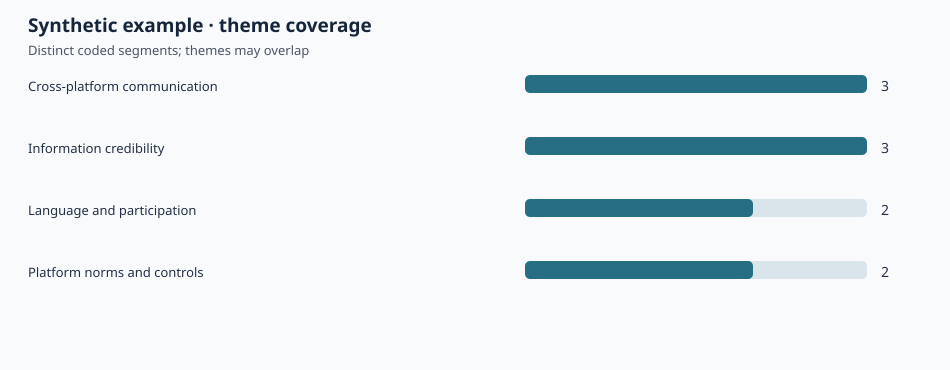

# Cross-Platform Information Practices — Qualitative Analysis Toolkit


A **2026 Python companion analysis tool** for transparent coding checks, distributed with a fully synthetic example. **This is not the original code for the 2023 dissertation**: the dissertation used NVivo-assisted thematic analysis, and this repository does not contain its interviews, coded dataset, or original analysis files. It does not reproduce dissertation findings.

A small, dependency-free Python workflow for **codebook validation, coded-segment summaries, platform-by-theme tables, and transparent qualitative-data quality checks**.

**Related research:** Hong Zhan, MSc Social Media and Management, University of York (2023): *Differences between the Use of Social Media by Chinese Students in the UK and Their Home Country's Mainstream Media Culture*.

## Research context and scope

The dissertation examined how Chinese students studying in the UK navigate social media, information credibility, communication and cultural belonging. The research involved **15 semi-structured interviews**, transcription and translation, and NVivo-assisted thematic analysis. This separately prepared 2026 tool provides a small, inspectable workflow for structured coding metadata. It is a methods companion and teaching/audit aid, not a claim about what was run for the thesis or a reanalysis of the original interviews.

## Input data

Two simple CSV tables, suitable for structured coding metadata:

| File | Required columns | Meaning |
|---|---|---|
| `illustrative_codebook.csv` | `code_id,theme,definition` | Defines each code and its parent theme |
| `synthetic_coded_segments.csv` | `interview_id,segment_id,platform,code_id` | Assigns one code to one segment in one interview |

The included example contains **four fictional interview IDs, eight fictional coded segments, and ten code assignments**. It does not include interview excerpts or identifiable participants. The example themes reflect the research areas summarized in the CV, not reported thesis frequency estimates.

A segment can have multiple codes, and different codes can belong to the same theme. The platform field is a **segment annotation**, not proof of participant usage, demographic behavior or platform popularity.

## Run

Python 3.10+; no external packages, API keys or downloads.

```bash
python3 qualitative_audit.py \
  --codebook examples/illustrative_codebook.csv \
  --coding examples/synthetic_coded_segments.csv \
  --output outputs \
  --label "Synthetic example"
```

Generated files:

- `summary.json` and `summary.md` — denominators, source hashes and interpretive limits.
- `themes.csv` and `codes.csv` — distinct interview/segment counts.
- `platform_theme.csv` — platform-tag × theme summary.
- `cooccurrence.csv` — segment-level theme co-occurrences.
- `theme_coverage.svg` — accessible, self-contained vector chart.

[View the generated illustrative chart](examples/output/theme_coverage.svg) · [Read the example summary](examples/output/summary.md)



### Test

```bash
python3 -m unittest discover -s tests -v
```

The test suite checks unique unit counts, multi-code segments, consistent platform tags, unknown and duplicate codes, schema validation, empty fields, restricted identifiers, output determinism, text escaping and input SHA-256 hashes. CI runs these tests on Python 3.12 and reproduces the synthetic example.

## Project layout

```text
qualitative_audit.py                 validation, counting, and report generation
examples/illustrative_codebook.csv   fictional code definitions
examples/synthetic_coded_segments.csv fictional annotations (no interview excerpts)
examples/output/                    checked-in outputs from the synthetic example
tests/                               standard-library unittest suite
.github/workflows/test.yml           test and example-reproduction CI
```

## Analytic specification

**Unit definitions.** An `interview_id` identifies a pseudonymous interview; `(interview_id, segment_id)` identifies a distinct segment; a code assignment is a `(interview_id, segment_id, code_id)` tuple. Counts at these levels are not interchangeable.

**Theme coverage.** Count unique interviews and segments associated with a theme. Multi-coded segments contribute to several themes; theme totals therefore cannot be summed to infer unique interviews or segments.

**Platform matrix.** Count distinct segments tagged with each platform/theme combination. This matrix describes coded segments only, not platform use prevalence.

**Co-occurrence.** Count segments assigned both themes in a pair. Co-occurrence is descriptive; it does not establish association, causality or coder agreement.

**Quality controls.** Reject mismatched headers, empty fields, duplicate code assignments, unknown codes, conflicting platform tags within a segment, and additional free-text columns. Source-file SHA-256 hashes make a specific run auditable.

## Research relevance

- **HCI / social computing:** qualitative coding and situated cross-platform interaction.
- **Information Science:** information credibility, platform context, and interpretive transparency.
- **Computational Social Science:** explicit unit definitions, multi-label counting and auditable descriptive summaries.

**Data ethics:** Only fictional coded rows are distributed in this repository. Do not publish identifiable interviews, transcripts, quotes, contact information, private NVivo projects or real participant matrices without an appropriate disclosure and ethics review.

For the full dissertation research narrative, see [the MSc academic case study](https://ivyhongzhan.github.io/Ivyhongzhan/research/masters/).
